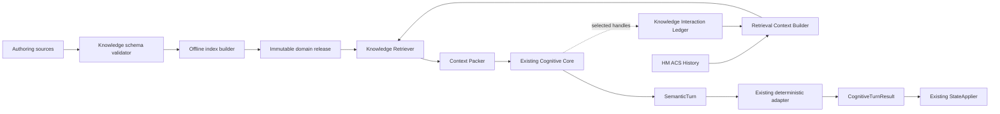

# Архитектура профессиональных знаний и Retrieval для Cognitive Core

Дата: 2026-10-13
Статус: архитектурный проект, без изменений production и без API-вызовов.

В документе используются три маркировки:

- **Подтверждённый факт** — непосредственно следует из текущего кода,
  документации или сохранённых экспериментальных артефактов.
- **Архитектурное решение** — рекомендуемый дизайн, который ещё не внедрён.
- **Требует эксперимента** — гипотеза, которую нельзя считать доказанной до
  контролируемой проверки.

## 1. Краткий вывод

Рекомендуется **модульная гибридная Knowledge/Retrieval architecture**, которая
добавляется перед существующим `CognitiveCore.propose()` и сохраняет один
production LLM-вызов:

```text
USER + Human Model + ACS + Dialogue History
                 │
                 ▼
       Retrieval Context Builder
                 │
       ┌─────────┴─────────┐
       ▼                   ▼
 Ordinary Knowledge     Safety lane
 Retrieval              high recall
       │                   │
       └─────────┬─────────┘
                 ▼
     Graph expansion + diversity
                 ▼
    Context packer under token budget
        ├─ Professional Knowledge
        ├─ Human Experience
        └─ Methodology fragments
                 ▼
       existing Cognitive Core call
                 ▼
 SemanticTurn → deterministic adapter
 → CognitiveTurnResult → StateApplier
```

Каноническая база должна быть набором версионированных структурированных
карточек, а не массивом произвольно нарезанных текстов. Для поиска создаются
производные смысловые retrieval views, lexical index, dense embeddings и граф
связей. Внешняя vector database на первом этапе не нужна: для ожидаемого объёма
достаточны SQLite/FTS5 и локальный векторный индекс или прямой cosine search по
предвычисленным векторам.

Retrieval должен быть гибридным: metadata/hierarchy + lexical BM25 + semantic
embeddings + перенос активных knowledge references из предыдущего хода + graph
expansion. Количество карточек в базе не ограничивается. Контекст ограничивается
**токен-бюджетом, релевантностью, разнообразием и safety-требованиями**, а не
фиксированным числом записей.

Все пригодные Human Experience-карты должны индексироваться и быть потенциально
доступными. Они проходят через тот же retrieval infrastructure, но остаются
отдельным epistemic типом: Knowledge Base описывает механизм и границы знания,
Human Experience — возможные жизненные проявления. Ни один из этих источников
не становится фактом Human Model автоматически.

## 2. Проверенная карта существующих источников знаний

### 2.1. Фактический production path

**Подтверждённый факт.** `DialogEngine` загружает Discovery memory, создаёт
`OpenAI(max_retries=0)`, вызывает один `CognitiveCore.propose()`, затем применяет
результат через `apply_cognitive_turn()` и сохраняет состояние
([`ai/dialog_engine.py:222-289`](../ai/dialog_engine.py)). Legacy engines в этом
пути не участвуют.

`CognitiveCore` собирает:

- current USER message;
- весь `HumanModel`;
- previous `ActiveConversationState`;
- history closure последних сообщений и evidence dependencies;
- Human Experience selection;
- production system prompt.

Это видно в [`ai/cognitive_core.py:286-385`](../ai/cognitive_core.py). После
одного strict structured-output вызова результат проходит SemanticTurn,
deterministic adapter и `CognitiveTurnResult` validation
([`ai/cognitive_core.py:165-253`](../ai/cognitive_core.py)).

### 2.2. Источники и их реальная доступность

| Источник | Семантическая роль | Production-доступность сейчас |
|---|---|---|
| `12_Cognitive_Cycle.txt` | Consultation Methodology и source of truth цикла | Не загружается; положения вручную отражены в prompt |
| Production system prompt | Постоянная policy + SemanticTurn contract | Полностью доступен |
| Новый methodology DOCX/PDF | Методика, карта механизмов, red flags, training/evaluation | Не доступен runtime |
| Human Experience V2 | 30 возможных жизненных/психологических карт | Каталог валидируется целиком, retrieval только `P001/P006/P007` |
| Human Model | Индивидуальные факты, значения, версии и статусы | Полностью доступен |
| ACS | Текущее выбранное действие и ResponseTargets | Доступен через input-scoped handles |
| DialogueHistory | История с evidence closure | Доступен частично; текущая JSON-проекция не передаёт `role` |
| Legacy `knowledge_base.json` | Сегменты по весу и типовые выводы | Не используется active path; непригоден как новая KB |
| Сохранённые experiments | Evidence о contract reliability и delivery | Не runtime knowledge; материал для engineering decisions |

**Подтверждённый факт.** Human Experience включён по умолчанию, однако selector
жёстко перечисляет только три ID
([`ai/human_experience.py:184-201`](../ai/human_experience.py),
[`ai/human_experience.py:243-250`](../ai/human_experience.py)). Это временный
pilot implementation, не продуктовое ограничение.

**Подтверждённый факт.** Cognitive Cycle уже задаёт правильную эпистемическую
границу: Human Experience не является доказательством о пользователе, а
Formulation не обязана искать единственную «истинную причину»
([`12_Cognitive_Cycle.txt:99-131`](../Research/Human_Experience/Weight/12_Cognitive_Cycle.txt),
[`12_Cognitive_Cycle.txt:285-322`](../Research/Human_Experience/Weight/12_Cognitive_Cycle.txt)).

### 2.3. Значение результатов экспериментов

- `semantic_reference_ab`: compact reference rules/examples повысили complete
  technical validity с `4/6` до `6/6`, но sample мал и quality superiority не
  доказана
  ([`FINAL_REPORT.md:67-146`](../experiments/semantic_reference_ab/FINAL_REPORT.md)).
- `semantic_delta_ab`: A и B дали по `10/15` complete validity; добавленный
  semantic-delta appendix не улучшил aggregate validity и получил худшую
  сообщённую blind quality score. Это аргумент против очередного общего prompt
  layer, но не против knowledge retrieval
  ([`TECHNICAL_REPORT.md:47-106`](../experiments/semantic_delta_ab/results/semantic-delta-ab-20261013T010202Z-8b1ed0be/TECHNICAL_REPORT.md)).
- Semantic delivery audit подтвердил, что structural `realizes` не гарантирует
  полноту передачи смысла, а вопрос может появиться в reply без ResponseTarget
  ([`SEMANTIC_DELIVERY_AUDIT.md:53-145`](../experiments/semantic_delta_ab/SEMANTIC_DELIVERY_AUDIT.md)).

Эти runs не проверяли полноценную Knowledge Base. Они не доказывают, что
knowledge injection улучшит консультацию, но задают обязательные технические и
экспериментальные guards.

## 3. Рекомендуемая структура Professional Knowledge Base

### 3.1. Каноническая единица — Knowledge Card

**Архитектурное решение.** Каноническая база хранится не как vector chunks, а
как предметные карточки. Векторные и текстовые представления строятся из них.

Минимальная схема карточки механизма:

```yaml
schema_version: knowledge-card.v1
id: weight.mechanism.restriction_evening_hunger
domain: weight_management
kind: mechanism
status: reviewed
version: 1.2.0
title: Физический голод после длительных ограничений
summary: Короткое профессиональное описание
mechanism:
  description: Как может формироваться механизм
  why_it_matters: Почему он меняет понимание ситуации
applicability:
  supporting_signals: []
  contradicting_signals: []
  required_context: []
  insufficient_on_their_own: []
alternatives:
  - target_id: weight.mechanism.emotional_regulation
    distinction: Что различает версии
discrimination:
  observations: []
  possible_questions: []
limits:
  prohibited_inferences: []
  uncertainty_note: ""
safety:
  red_flag_ids: []
  referral_scope: none
relations:
  related_mechanism_ids: []
  related_human_experience_ids: []
sources:
  - source_id: nice.ng246
    locator: section-or-page
    support_kind: guideline
review:
  reviewer_role: domain_expert
  reviewed_at: YYYY-MM-DD
  next_review_at: YYYY-MM-DD
```

### 3.2. Почему нужны именно эти поля

| Поле | Назначение |
|---|---|
| `id/version/status` | Воспроизводимость, deprecation и rollout без смешения версий |
| `kind/domain` | Domain routing и раздельное применение mechanism/safety/general-info |
| `summary/mechanism` | Пользовательская полезность без необходимости загружать источник целиком |
| `supporting/contradicting` | Поиск не только похожего, но и опровергающего материала |
| `insufficient_on_their_own` | Запрет вывода причины из одного слабого признака |
| `alternatives` | Сохранение materially different explanations |
| `discrimination` | Наблюдения/вопросы, которые могут изменить Formulation или Decision |
| `prohibited_inferences` | Явная граница против диагноза, психологизации и стереотипа |
| `red_flag_ids/referral_scope` | Независимый safety route |
| `related_human_experience_ids` | Связь механизма с возможными жизненными проявлениями |
| `sources/review` | Проверяемость и управление качеством знаний |

Карточка не должна содержать обязательную готовую реплику. Допустимы
illustrative examples, но они хранятся отдельно как training/evaluation
material, чтобы Cognitive Core не копировал один шаблон.

### 3.3. Типы knowledge objects

В одной схеме с discriminated `kind` рекомендуется поддержать:

- `mechanism` — объяснение поддерживающей закономерности;
- `general_principle` — описательное знание, не персональная рекомендация;
- `differential` — специально оформленная пара/группа альтернатив;
- `safety_signal` — red flag и граница компетенции;
- `referral_rule` — тип подходящей помощи, без диагноза;
- `method_reference` — контекстно подключаемое правило методики;
- `source_record` — библиографическая запись и evidence status.

Не следует смешивать в одном объекте механизм, жизненный рассказ и решение для
пользователя. Решения/планы находятся за текущим Product Boundary.

### 3.4. Физическое хранение и сборка

Рекомендуемая структура domain package:

```text
knowledge/
  shared/
    schemas/
    methodology/
    safety/
  weight_management/
    manifest.json
    sources/
    mechanisms/
    differentials/
    safety/
    human_experience/
    relations.json
  built/
    <release-id>/
      catalog.sqlite
      vectors.bin
      graph.json
      build_manifest.json
      validation_report.json
```

Authoritative source — reviewable JSON/YAML/Markdown в Git. Built index —
производный immutable artifact с hashes исходников, schema version, embedding
model snapshot и build tool version. Индекс можно пересобрать; ручное
редактирование built files запрещено.

## 4. Принципы Semantic Chunking

### 4.1. Не резать знание по фиксированному числу символов

**Архитектурное решение.** Atomic boundary задаётся профессиональным смыслом:
одна карточка описывает один проверяемый mechanism/principle/safety rule.
Связанные alternatives и limits не отделяются без ссылок.

### 4.2. Retrieval views вместо разрушения карточки

Из каждой карточки offline builder создаёт несколько индексируемых views:

1. `mechanism_view`: summary + mechanism + why_it_matters;
2. `signals_view`: supporting + contradicting + insufficient signals;
3. `differential_view`: alternatives + distinctions + observations;
4. `safety_view`: red flags + prohibited inferences + referral scope;
5. `language_view`: проверенные бытовые paraphrases и synonyms.

Каждый view хранит `parent_card_id`, `facet`, `version`. Search может найти
отдельный facet, но context packer возвращает компактную целостную проекцию
карточки плюс нужные relations. Так embeddings не разрывают mechanism и
ограничения применимости.

### 4.3. Размер контекста

Не вводится глобальный предел «N карточек». В каждом запросе действует:

- token budget для `professional_knowledge`;
- token budget для `human_experience`;
- зарезервированный safety budget, который ordinary retrieval не может занять;
- diversity rule: не заполнять весь budget семантическими дублями;
- minimum completeness: если включён mechanism, включить его main limitation и
  хотя бы одну существенную alternative/contradiction, когда она существует.

Количество переданных объектов является следствием содержания и бюджета, а не
размера всей базы.

## 5. Модель связей Knowledge Base ↔ Human Experience

### 5.1. Разные epistemic типы

```text
Knowledge mechanism
  "restriction may increase physical hunger"
          │ related_manifestation
          ▼
Human Experience
  "весь день держусь, вечером срываюсь, начинаю заново"
          │ may_be_recognized_as
          ▼
Individual Human Model
  только после evidence/correction пользователя
```

- Knowledge Base отвечает: **что профессионально возможно и как различать**.
- Human Experience отвечает: **как это иногда проявляется и узнаётся в жизни**.
- Human Model отвечает: **что имеет основание именно у этого человека**.

### 5.2. Типы graph edges

- `mechanism_has_manifestation`;
- `experience_may_express_mechanism`;
- `mechanism_competes_with`;
- `mechanism_co_occurs_with`;
- `distinguished_by`;
- `contraindicated_by`;
- `raises_safety_signal`;
- `broader_than` / `narrower_than`;
- `supersedes_knowledge_version`.

Edges направленные и типизированные. `may_express` никогда не означает
`proves`. Graph используется для candidate expansion, а не для автоматического
вывода истины о пользователе.

### 5.3. Доступ ко всем 30 HE-картам

Жёсткий список `P001/P006/P007` заменяется индексом всех карт со статусом
`approved_for_retrieval`. Перед включением требуется review существующих 30
карт на grounding, duplication, sensitivity и source quality. Все прошедшие
review карты индексируются; ни одна не обязана попадать в конкретный запрос.

Для каждой HE-карты нужны:

- `recognition_signals` и `negative_signals`;
- `alternative_explanations`;
- `avoid/prohibited_inferences`;
- links к mechanism cards;
- sensitivity и safety metadata;
- version/review status.

Единый retrieval engine может искать оба корпуса, но выдаёт два раздельных
раздела. Knowledge имеет более высокий статус для общего механизма; HE не
штрафуется как «менее истинный», потому что решает другую задачу. При конфликте
Cognitive Core получает competing candidates и выбирает discrimination,
осторожную working version или abstention.

## 6. Архитектура Retrieval

### 6.1. Сравнение подходов

| Подход | Сильные стороны | Слабые стороны | Роль в рекомендации |
|---|---|---|---|
| Keyword/BM25 | Дёшев, прозрачен, локален, хорошо ловит точные термины | Плохо переносит paraphrase, короткое «скорее второе», negation | Один источник кандидатов |
| Semantic embeddings | Paraphrase и смысловая близость | Similarity не равна применимости; может игнорировать negation и вернуть шаблон | Второй источник кандидатов |
| Metadata filtering | Надёжно ограничивает domain/kind/status/safety | Требует качественной разметки, сам ничего не находит | Обязательный pre/post-filter |
| Hierarchical retrieval | Сначала область, затем механизм; экономит поиск | Ошибка верхнего уровня может скрыть нужное | Soft routing, не жёсткое исключение |
| Graph retrieval | Возвращает alternatives, limits и связанный HE | Нужен curated graph; плохо стартует без anchor | Expansion после candidate generation |
| Cross-encoder reranker | Лучше оценивает pair relevance | Модель/latency/сложность, ещё одна точка версии | Не на первом этапе |
| LLM retrieval/router | Понимает сложный контекст | Дополнительный API call, стоимость и unreliability | Только будущий experiment |

### 6.2. Рекомендуемый multi-stage pipeline

```mermaid
flowchart TD
    U[Current USER] --> Q[Retrieval Context Builder]
    HM[Human Model] --> Q
    ACS[Previous ACS] --> Q
    DH[Dialogue History] --> Q
    KL[Knowledge Interaction Ledger] --> Q
    Q --> F[Metadata and status filters]
    F --> L[Lexical FTS5 retrieval]
    F --> V[Local dense retrieval]
    Q --> C[Carry-forward active knowledge]
    Q --> S[Independent safety retrieval]
    L --> R[Reciprocal-rank fusion]
    V --> R
    C --> R
    R --> N[Negation rejection and history constraints]
    N --> G[Graph expansion alternatives limits HE]
    S --> P[Token-budget context packer]
    G --> P
    P --> CC[Cognitive Core one call]
```



Этапы:

1. **Context builder** создаёт структурированный query bundle, не принимая
   решения о человеке.
2. **Metadata filter** ограничивает domain, language, release status и типы.
3. **Candidate union** объединяет lexical и dense результаты, а также active
   carry-forward knowledge.
4. **RRF** (reciprocal rank fusion) объединяет rankings без плохо
   калиброванных абсолютных score thresholds.
5. **Epistemic constraints** понижают/исключают ранее отвергнутые версии,
   сохраняют uncertain alternatives и отмечают новые основания.
6. **Graph expansion** добавляет materially different alternatives,
   contradiction/limits, related HE и safety links.
7. **Diversity selection** предотвращает пять перефразировок одной гипотезы.
8. **Context packer** собирает компактные projections под budgets.

### 6.3. Технологический выбор

На первом production-capable этапе:

- SQLite для catalog metadata, edges и FTS5;
- локальная multilingual embedding model с pinned artifact hash;
- предвычисленные card vectors;
- query embedding локально;
- cosine search в памяти/NumPy для сотен или нескольких тысяч views;
- при измеренной необходимости — `sqlite-vec`, HNSW или FAISS;
- внешняя vector service только после доказанного масштаба/операционной нужды.

Это сохраняет privacy, не создаёт отдельный network dependency и позволяет
детерминированно воспроизводить corpus release. Конкретную embedding model
нужно выбрать benchmark-ом на русском языке; популярность модели не является
основанием.

### 6.4. Почему embeddings недостаточно

Embedding может считать близкими:

- «после одного вечера всё бросаю»;
- «после одного вечера **не** бросаю».

Поэтому dense score не материализует гипотезу. Отрицания и corrections входят
в structured query constraints, rejected versions получают penalty/exclusion,
а final semantic Decision остаётся у Cognitive Core.

## 7. Использование Human Model, ACS и Dialogue History

### 7.1. Retrieval Query Bundle

```yaml
current_turn:
  text: "Да, скорее второе"
active_conversation:
  target_handle: previous_target_1
  interaction: evaluation
  content_summary: "сравнение двух механизмов"
  linked_knowledge_ids: [K1, K2]
human_model:
  supported: []
  partial: []
  uncertain: []
  rejected: []
  corrections: []
history:
  recent_user_and_system_messages: []
retrieval_task:
  purpose: resolve_active_target_and_choose_next_move
```

Python формирует bundle из типизированных объектов. Он не решает, что «второе»
означает K2. Он гарантирует, что K1 и K2 не исчезнут из доступного контекста;
Cognitive Core интерпретирует ответ вместе с ACS.

### 7.2. Knowledge Interaction Ledger

Для устойчивых коротких ответов нужен технический sidecar, отдельный от Human
Model:

```text
turn_id
available_knowledge_ids
available_he_ids
action_content_id → referenced knowledge handles
response_target_id → referenced knowledge IDs
user_resolution: supported / partial / rejected / uncertain / not_addressed
```

Это не новый reasoning engine и не источник истины о человеке. Ledger отвечает
только на технический вопрос: какие knowledge candidates были доступны и с
каким активным содержанием связаны.

Чтобы точно заполнить ledger, долгосрочно потребуется минимальная model-facing
семантика `knowledge_basis_handles` у ActionContent. LLM выбирает **какое знание
использовала**, Python разрешает input-scoped handle в stable ID. Это следует
тем же принципам, что previous-target handles. Добавление поля — отдельное
решение после Experiment A; для первого lab injection контракт можно не менять.

### 7.3. Статусы и исправления

- `SUPPORTED`: не делает mechanism объективной причиной; повышает его
  индивидуальную поддержку только в границах USER evidence.
- `PARTIAL`: сохраняет подтверждённую часть и alternatives.
- `REJECTED`: тот же claim не предлагается снова без нового наблюдения.
- `UNCERTAIN`: остаётся кандидатом, но не вытесняет другие версии.
- `CORRECTED`: retrieval использует актуальную replacement version.

Knowledge refs не должны автоматически создавать Human Model item. Создание
`SYSTEM_PROPOSED` остаётся результатом SemanticTurn + materialization и текущих
evidence rules.

### 7.4. Dialogue History

Current `_message_view()` передаёт `id`, `sequence`, `text`, но не `role`
([`ai/cognitive_core.py:388-390`](../ai/cognitive_core.py)). Retrieval builder
работает с исходными typed `DialogueMessage` и должен сохранять role. Следует
отдельно проверить, нужно ли добавить role и в Cognitive Core projection; это
не обязательная часть первого lab retrieval, но текущая неоднозначность должна
быть закрыта до масштабирования.

## 8. Подключение Consultation Methodology

### 8.1. Три уровня методики

1. **Always-on constitution:** grounding, uncertainty, useful delta,
   correctability, Product Boundary, consent, no diagnosis/manipulation.
2. **Action-selection rubric:** компактное правило выбора Question vs
   working version vs Reflection/Recognition vs Stop/Transition.
3. **Contextual method modules:** correction, short answer, competing
   hypotheses, episode analysis, recognition, safety, transition.

Полный methodology document не загружается в каждый запрос. Always-on часть
остаётся в system prompt. Contextual modules подключаются по структурному
состоянию: interaction type ACS, наличие correction/rejection, safety candidate,
direct user question, накопленная sufficiency. Модуль не задаёт обязательный
скрипт и не выбирает Decision вместо LLM.

### 8.2. Принцип выбора следующего действия

Методика должна формулировать одну положительную задачу:

> Выбрать ход с максимальным ожидаемым полезным изменением Human Model,
> Formulation или следующего допустимого Decision при минимально необходимой
> нагрузке и сохранении безопасности.

Форма не имеет глобального приоритета:

- вопрос нужен, если доступное наблюдение materially различает версии;
- working version нужна, если её Evaluation сама даст useful delta;
- Reflection/Recognition нужна, если связь уже достаточно grounded;
- Stop нужен, если дальнейшее исследование не добавляет ценности;
- Transition нужен, если следующий полезный шаг выходит в personal solution
  design и получено meaningful consent.

Это согласуется с текущим Value/Sufficiency
([`12_Cognitive_Cycle.txt:346-397`](../Research/Human_Experience/Weight/12_Cognitive_Cycle.txt))
и не вводит квоту вопросов.

### 8.3. Prompt Engineering implications

Дизайн следует R02/R03/R06/R09/R19:

- knowledge и HE передаются как недоверенные data blocks, не инструкции;
- core methodology имеет более высокий instruction priority;
- retrieval context краток и релевантен;
- knowledge card не является user fact;
- выбранные model/config/corpus версии логируются;
- schema validation и consultation quality измеряются отдельно.

Не следует добавлять длинный список новых запретов в production prompt. Нужны
короткая инструкция по роли retrieved material и проверенные examples на уровне
lab package.

## 9. Safety architecture

### 9.1. Почему обычного top-k недостаточно

Редкий red flag может получить низкий similarity score и исчезнуть из top-k.
Поэтому safety не конкурирует за остаток ordinary knowledge budget.

### 9.2. Двухконтурная схема

```text
Always-on safety constitution
             +
Independent high-recall safety candidate retrieval
             +
Mandatory inclusion of triggered safety cards
             +
Cognitive Core semantic assessment without diagnosis
             +
Appropriate routing, not ordinary sales handoff
```

Safety candidate retrieval использует union:

- explicit high-precision indicators;
- lexical variants;
- semantic search по current + recent history;
- related safety edges от ordinary mechanism cards;
- known medication/rapid-change/eating-disorder/self-harm metadata.

Срабатывание означает только «передать safety knowledge модели», а не диагноз.
Карточка указывает, что можно сказать, чего нельзя выводить и к какому типу
помощи направлять.

### 9.3. Fail-safe policy

- acute self-harm/emergency scope прекращает обычную Discovery/sales logic;
- suspected eating disorder или unexplained medical change не превращается в
  диету/психологическое объяснение;
- обычный live weight consultant не считается заменой врачу/психологу;
- safety event и corpus version логируются без избыточной чувствительной
  информации;
- если safety index недоступен, always-on compact rules остаются; система пишет
  diagnostics и не делает вид, что safety retrieval состоялся.

**Открытый вопрос владельца:** требуемый уровень гарантии. Prompt + retrieval не
дают нулевую вероятность пропуска. Для regulated/high-risk deployment может
понадобиться отдельный validated local classifier или специализированный safety
call. Это отдельное product/safety решение, не должно скрыто внедряться как
обычный retrieval.

## 10. Масштабирование на другие предметные области

Переиспользуются:

- Cognitive Core и SemanticTurn;
- Human Model/ACS/DialogueHistory;
- retrieval pipeline и index builder;
- общая consultation constitution;
- evidence/review/version contracts;
- safety interface.

Заменяются или расширяются domain package:

- mechanism/general-principle cards;
- domain taxonomy;
- domain-specific Human Experience;
- safety/referral cards;
- source and expert review roster.

Domain routing начинается с явного продукта/проекта, а не с автоматической
универсальной классификации. Multi-domain retrieval можно добавить позже как
soft routing с fallback к shared safety. Не нужно сейчас строить общую ontology
для всех будущих консультаций.

## 11. Сравнение архитектурных альтернатив

### A. Минимальное расширение текущего Cognitive Core

**Компоненты:** JSON cards, metadata + FTS5, расширенный HE selector, context
injection прямо в `_input_view()`.
**Data path:** HM/ACS/history → simple query text → FTS → cards → Core.
**Изменения:** новый loader/retriever и input block; one-call сохраняется.
**Плюсы:** быстро, локально, минимальная стоимость/latency.
**Минусы:** paraphrase и short-answer continuity слабее; alternatives и graph
relations быстро становятся ручной логикой; масштабирование потребует
переделки.
**Риск:** закрепить временный selector как постоянную архитектуру.
**Вердикт:** подходит как Experiment A harness, недостаточен как целевая система.

### B. Модульная гибридная Knowledge/Retrieval architecture

**Компоненты:** versioned domain packages, schema validator, offline index
builder, SQLite/FTS, local embeddings, graph, context builder, safety lane,
packer, interaction ledger.
**Data path:** typed conversation state → hybrid candidate generation →
epistemic filters → graph expansion → budgeted separate KB/HE blocks → Core.
**Изменения:** независимый knowledge package; read-only runtime retrieval;
input-view extension; позже минимальные knowledge handles для observability.
**Плюсы:** устойчивость к paraphrase/short answers, alternatives, all-HE access,
versioning, local work, future domains, safety separation.
**Минусы:** требует authoring/review process, embedding benchmark и нового
технического состояния ledger.
**Стоимость:** LLM cost не растёт числом calls; input tokens умеренно растут;
локальный retrieval дешёв.
**Задержка:** один локальный query embedding + SQLite/search; измерить pilot-ом.
**Вердикт:** рекомендуемый target.

### C. LLM-planner / agentic RAG

**Компоненты:** отдельный LLM query planner, retrieval, knowledge/safety agents,
writer Core.
**Data path:** state → planner call → tools/indices → Core/writer call.
**Плюсы:** может лучше переформулировать сложный запрос и выбирать corpus.
**Минусы:** минимум два calls, latency/cost, новые inconsistent states,
сложная воспроизводимость и safety surface; противоречит текущей one-call
architecture.
**Вердикт:** только будущий falsification experiment, если B не обеспечивает
retrieval quality.

### Сводная матрица

| Критерий | A | B | C |
|---|---:|---:|---:|
| Качество paraphrase retrieval | Среднее | Высокое ожидаемое | Высокое ожидаемое |
| Short-answer continuity | Низкое/среднее | Высокое через carry-forward | Высокое, но дорого |
| Alternatives/graph | Ограничено | Нативно | Нативно |
| Safety separation | Частично | Полноценно проектируется | Возможно, сложнее |
| LLM calls | 1 | 1 | 2+ |
| Локальная работа | Да | Да | Не всегда |
| Сложность | Низкая | Средняя | Высокая |
| Масштабирование | Ограниченное | Хорошее | Хорошее, преждевременное |
| Воспроизводимость | Хорошая | Хорошая при pinned index | Сложнее |

## 12. Конкретная рекомендуемая архитектура

Рекомендуется вариант **B**, внедряемый поэтапно и проверяемый до production.

### 12.1. Component boundaries



`Knowledge Retriever` не является Engine, принимающим консультационные
решения. Его отдельная ответственность — вернуть bounded candidates и trace.

### 12.2. Новый model input

```json
{
  "professional_knowledge": {
    "release_id": "weight-knowledge-2026.10.1",
    "abstained": false,
    "candidates": [
      {
        "handle": "knowledge_1",
        "kind": "mechanism",
        "summary": "...",
        "supporting_signals": ["..."],
        "contradicting_signals": ["..."],
        "alternatives": ["knowledge_2"],
        "discriminating_observations": ["..."],
        "limits": ["..."],
        "safety_refs": []
      }
    ]
  },
  "human_experience": {
    "release_id": "weight-he-2.x",
    "candidates": [
      {
        "handle": "experience_1",
        "possible_manifestation": "...",
        "alternative_explanations": ["..."],
        "avoid": "...",
        "related_knowledge_handles": ["knowledge_1"]
      }
    ]
  },
  "retrieval_trace": {
    "active_carried_handles": ["knowledge_1", "knowledge_2"],
    "rejected_claims_present": true,
    "safety_lane_status": "checked_no_candidate"
  }
}
```

Stable IDs модели не нужны: она использует input-scoped handles. Python хранит
mapping и release hashes. Retrieved text явно маркируется как data, not
instructions, в соответствии с R19.

### 12.3. Что меняется в Cognitive Core

После экспериментального подтверждения потребуется:

1. принимать `KnowledgeSelection` вместе с `HumanExperienceSelection`;
2. добавить отдельные input blocks, не смешивая их с Human Model;
3. компактно описать epistemic role retrieved knowledge в system prompt;
4. сохранять один `chat.completions.create()`;
5. возможно добавить `knowledge_basis_handles` к ActionContent для ledger —
   только после отдельного technical pilot;
6. не менять `DecisionIntent`, StateApplier и HM/ACS semantics без отдельной
   доказанной необходимости.

## 13. Примеры движения данных

### 13.1. Вечернее переедание после работы

**Диалог:** «После тяжёлой недели пропускаю обед, вечером переедаю, потом всё
бросаю».

1. Context builder включает current text и HM/history.
2. Lexical+dense retrieval находят:
   - физический голод после restriction;
   - black-and-white evaluation/lapse-to-relapse;
   - fatigue/emotional regulation как alternative.
3. Graph добавляет HE `P001`, `P006`, возможно `P007`, но не объявляет ни одну
   истинной.
4. Packer даёт Core mechanisms, distinctions и limits.
5. Core может выбрать grounded working version с двумя частями либо один
   discriminating observation.
6. Только USER evaluation меняет HM.

### 13.2. Короткий ответ «Да, скорее второе»

Предыдущий ACS содержит ResponseTarget, связанный с содержанием, где
сопоставлялись K1 и K2. Interaction ledger переносит оба knowledge IDs в новый
retrieval package независимо от отсутствия ключевых слов. Cognitive Core видит
previous content и решает, что «второе» адресует K2. Python retrieval этого не
угадывает.

### 13.3. Коррекция гипотезы

**USER:** «Нет, один вечер для меня не провал; я обычно продолжаю».

1. Current correction и previous target попадают в query bundle.
2. P001/black-and-white claim помечается rejected/corrected по результату
   CognitiveTurn, а не lexical retrieval.
3. Следующий retrieval снижает тот же claim и поднимает alternatives:
   ожидания результата, объективная устойчивость режима, physical hunger.
4. Отвергнутая версия может вернуться только при новом конкретном основании,
   которое trace должен зафиксировать.

### 13.4. Safety case

**USER:** сообщает повторную потерю контроля и очищающее поведение.

1. Ordinary retrieval может найти emotional eating, но safety lane независимо
   находит eating-disorder signal.
2. Safety card включается в reserved budget вне rank cutoff.
3. Core не ставит диагноз, прекращает обычную продающую/диетическую логику и
   предлагает подходящую профильную помощь.
4. Обычный Telegram consultant handoff не подменяет такую маршрутизацию.

### 13.5. Нет подходящего знания

Если lexical/dense scores низки, metadata не подходит или candidates
противоречат подтверждённым данным, retrieval возвращает `abstained=true`.
Cognitive Core использует только HM/ACS/history и может задать полезный вопрос,
дать grounded Reflection или остановить ось. База не должна заставлять выбрать
«ближайший» сценарий.

## 14. Программа лабораторной проверки

### 14.1. Experiment A — умеет ли Core использовать качественное знание

Retrieval исключён: профессиональный эксперт заранее выбирает materials.

Условия:

- `A0`: current production без дополнительного knowledge;
- `A1`: идеально подобранные structured knowledge cards;
- `A2`: те же cards без HE;
- `A3`: knowledge + связанный HE.

Фиксируются model snapshot, prompt, schema, state, call order и repetitions.
Главные вопросы: выросла ли содержательность и точность гипотез; не выросли ли
навязывание, questions burden и technical invalidity.

### 14.2. Experiment B — умеет ли система находить знание

Сравниваются:

- ideal expert-selected set;
- hybrid retrieval set;
- lexical-only baseline;
- abstention/no-additional-knowledge baseline.

Retrieval оценивается отдельно до LLM:

- recall@budget нужного mechanism;
- inclusion of materially different alternative;
- red-flag recall;
- rejected-version reintroduction rate;
- irrelevant candidate burden;
- HE link precision;
- latency и context tokens.

После этого оценивается end-to-end consultation.

### 14.3. Отдельный Human Experience experiment

Сравнить:

- current three-card selector;
- all-reviewed-card hybrid retrieval;
- Knowledge-only;
- Knowledge + HE.

Нужно измерять false recognition, user correction quality, unsupported
psychologizing и способность ничего не использовать.

### 14.4. Минимальный набор сценариев

1. restriction/physical hunger vs emotional regulation;
2. lapse-to-relapse vs пользователь прямо отрицает «провал»;
3. короткий ответ на две предложенные версии;
4. work/sleep/environment constraint вместо мотивации;
5. medical/medication rapid-change red flag;
6. eating-disorder signal;
7. no-match/insufficient data;
8. corrected/rejected hypothesis returns without new basis;
9. direct action question at Product Boundary;
10. same surface words with opposite negation.

Каждый сценарий должен быть ветвящимся и multi-turn, потому что retrieval по
одной реплике не проверяет ACS/HM continuity.

### 14.5. Метрики и review

- technical: parse/schema/SemanticTurn/adapter/CognitiveTurnResult;
- retrieval: recall, diversity, contradiction, safety, abstention;
- consultation: useful Human Model delta, groundedness, naturalness;
- epistemic: hypothesis vs fact, correction, rejected-version guard;
- behavior: question burden, echo, questionnaire pattern;
- boundary: no diagnosis/personal solution design;
- operational: input/output tokens, local retrieval latency, total latency;
- safety: missed/false-positive routing.

Единица repeatability — независимый production selection, не evaluator vote.
Human expert review проводится blind по заранее замороженной rubric. LLM
evaluator, если используется, является дополнительным сигналом, не заменой.

## 15. Риски и открытые вопросы

### 15.1. Технические риски

- Dense similarity игнорирует отрицание или выбирает эмоционально яркую карту.
- Graph expansion раздувает контекст.
- Некачественная taxonomy создаёт скрытый bias.
- Добавление knowledge handles увеличивает SemanticTurn burden.
- Локальная embedding model может быть слабой на разговорном русском.
- Corpus update без pinned release разрушит воспроизводимость.

### 15.2. Продуктовые и safety риски

- Professional explanation может быть воспринято как диагноз.
- HE может подтолкнуть к ложному узнавания.
- Sales objective может конкурировать с safety/referral.
- Источники разной силы могут выглядеть равными.
- Хранение sensitive retrieval traces требует privacy policy.

### 15.3. Вопросы владельца продукта

1. Кто является domain owner и утверждает knowledge cards?
2. Какой evidence threshold нужен для `reviewed/production`?
3. Можно ли выпускать все 30 HE-карт после review или часть должна остаться
   research-only?
4. Какие red flags и destinations входят в product scope?
5. Допустим ли отдельный safety classifier/call, если one-call Core не даёт
   нужной гарантии?
6. Нужно ли хранить knowledge interaction ledger и каков retention/privacy?
7. Допустимо ли минимально расширить SemanticTurn knowledge handles ради
   provenance, или на первом релизе достаточно retrieval trace?
8. Какой максимальный context-token и latency budget?
9. Кто проводит human expert blind evaluation?
10. Какие новые домены реально планируются первыми?

## 16. Пошаговый план возможной реализации

### Фаза 0. Решения и контракты

1. Утвердить четыре semantic слоя и owner каждого.
2. Утвердить evidence/safety/review policy.
3. Зафиксировать Knowledge Card, HE Card и relation schemas.
4. Определить metrics, token budget и release gates.

### Фаза 1. Lab corpus

5. Перевести representative mechanisms из методологии в карточки без
   искусственного ограничения общего будущего размера.
6. Провести экспертный review sources, limits и red flags.
7. Нормализовать и проверить все 30 HE-карт; назначить readiness statuses.
8. Построить relations KB ↔ HE ↔ alternatives ↔ safety.
9. Создать immutable lab release и offline validators.

### Фаза 2. Experiment A без Retrieval

10. Добавить lab-only injection заранее выбранных cards в exact current Core.
11. Выполнить frozen matched study knowledge availability.
12. Не продолжать, если растут unsupported claims, false recognition или
    technical failures.

### Фаза 3. Retrieval prototype

13. Реализовать SQLite/FTS5 index builder.
14. Выбрать local multilingual embedding model по offline Russian benchmark.
15. Добавить graph expansion, token packer и independent safety lane.
16. Реализовать trace/ledger сначала в lab artifacts, не в production memory.
17. Проверить Experiment B и расширенный HE experiment.

### Фаза 4. Production integration gate

18. При подтверждённом выигрыше добавить read-only retriever перед
    `CognitiveCore.propose()`.
19. Добавить `professional_knowledge` и обновлённый `human_experience` blocks.
20. Сохранить one-call, selected-only, current adapter и StateApplier.
21. Отдельно решить необходимость model-declared knowledge handles.
22. Добавить observability: corpus hash, candidate IDs, safety lane status,
    tokens, latency, abstention — без сохранения скрытого reasoning.

### Фаза 5. Controlled rollout

23. Shadow retrieval без влияния на reply.
24. Ограниченный canary с rollback на no-knowledge baseline.
25. Review false positives, corrections, safety routes и cost.
26. Только после gate расширять corpus и domains.

### Итоговая граница

Данный проект не требует сейчас нового Cognitive Engine, второго LLM-вызова,
внешней vector database или изменения Human Model/ACS. Он требует отдельной,
версионированной и проверяемой инфраструктуры знаний и Retrieval, которая
поставляет candidates существующему Cognitive Core. Решение о том, что означает
ситуация человека и какой следующий ход полезен, остаётся у LLM; Python хранит,
ищет, ограничивает, связывает и технически упаковывает знания.

Production changes: `0`.
API calls: `0`.
Commit/push: не выполнялись.
